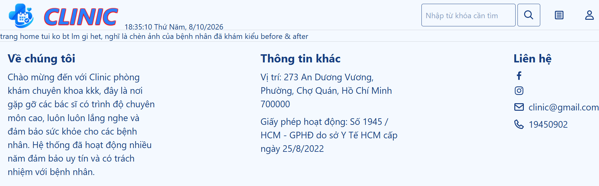
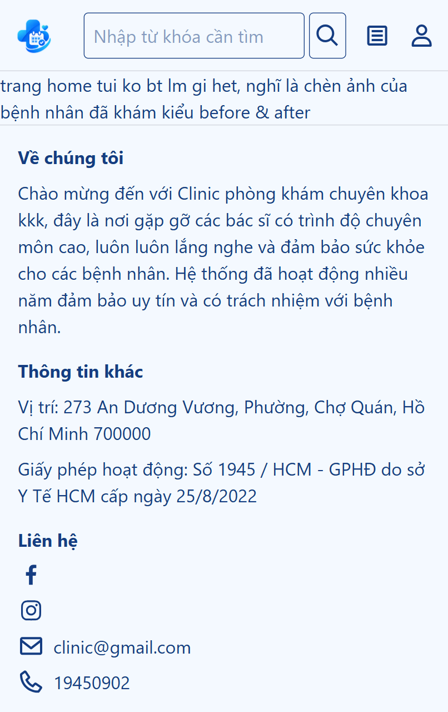
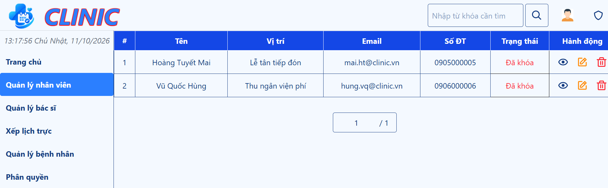
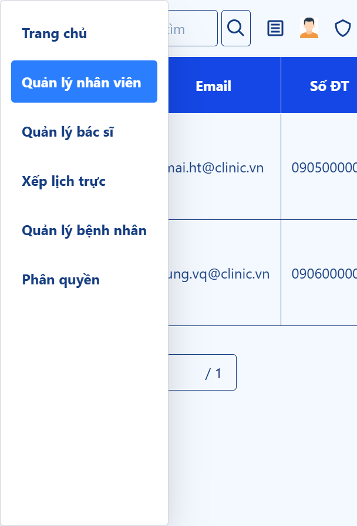
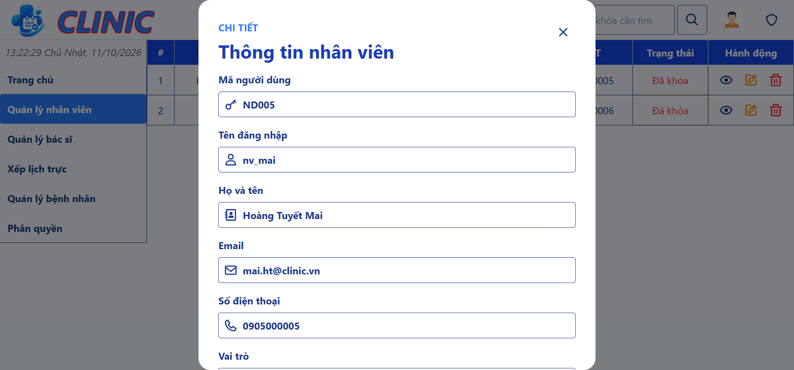
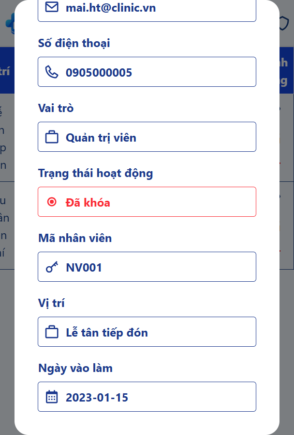
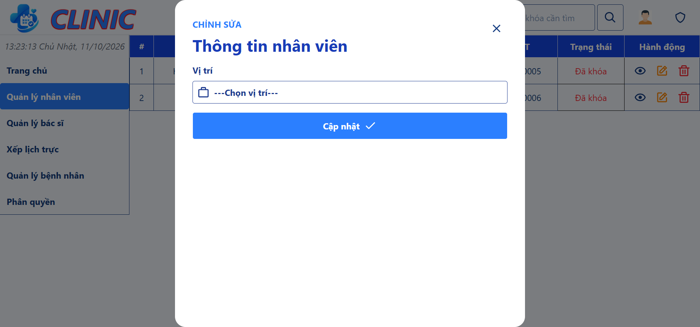
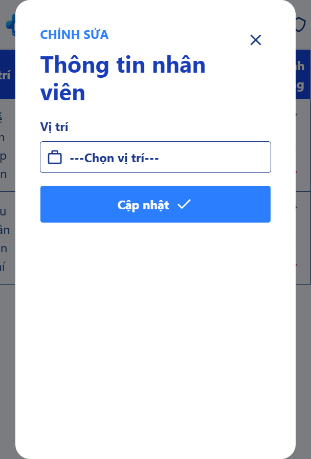
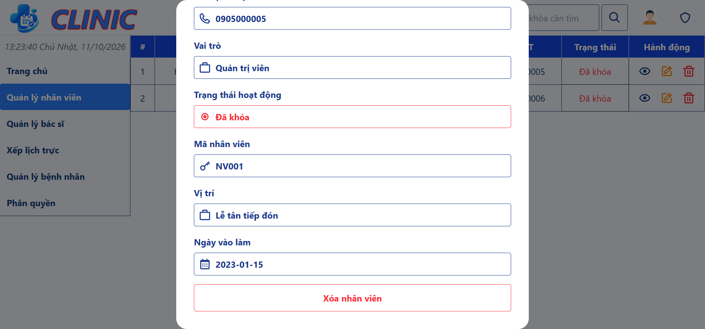
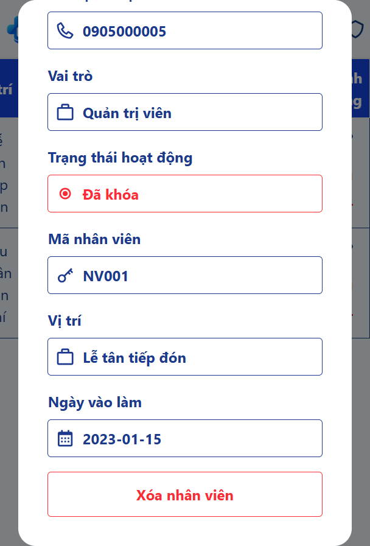

# Clinic Management System

## Build Windows releases

Requirements: Windows, Git, and a current Node.js LTS release with npm.

```powershell
git clone https://github.com/DinoTang/clinic-management-system.git
cd clinic-management-system\_frontend
npm ci
```

Build the Clinic Management installer:

```powershell
npm run electron:build
```

Build the MediGo installer:

```powershell
npm run electron:build:mobile
```

Build both installers:

```powershell
npm run electron:build:all
```

Installers are written to `_frontend/release/` and
`_frontend/release-mobile/`. These scripts create **Windows `.exe` installers**;
they do not create an Android APK. Release files and `node_modules` are generated
locally and must not be committed.

## Desktop workspaces and login

The desktop app has separate workspaces for administrators, doctors, and staff.
On localhost and in the Electron app, choose a temporary role to preview the
corresponding workspace without logging in. The Admin preview contains sample
data for the dashboard, accounts, patients, doctors, specialties, rooms,
schedules, appointments, medicines, services, invoices, and reports. Admin
preview edits remain in frontend memory and are not saved to the database.
Temporary role selection does not authenticate or authorize API requests.

Use **Đăng nhập bằng tài khoản thật** to authenticate through the backend and
open the workspace for the role returned by the account. For this option and
backend features to work in the packaged app, the Spring backend must be
running at `localhost:8080` and connected to the configured database. The
Windows installer packages the desktop frontend; it does not start the backend
or database as services.

# Screenshot giao diện

---

## Trang chủ (Home)

### Desktop


### Mobile


---

## Quản lý nhân viên

### 1. Danh sách nhân viên

#### Desktop


#### Mobile


### 2. Xem thông tin nhân viên

#### Desktop


#### Mobile


### 3. Chỉnh sửa thông tin nhân viên

#### Desktop


#### Mobile


### 4. Xóa nhân viên

#### Desktop


#### Mobile
